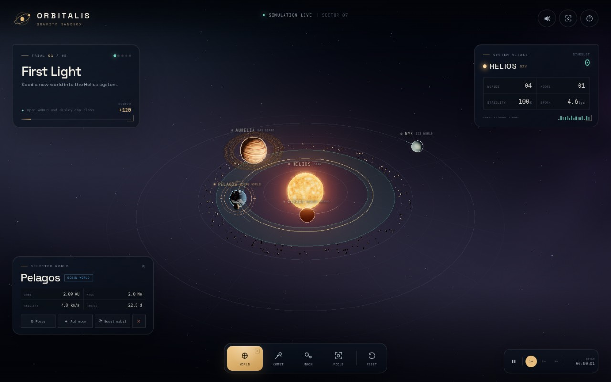
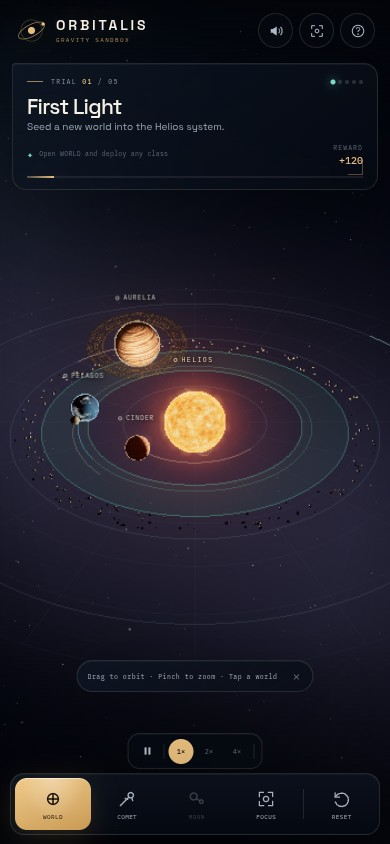

# ORBITALIS — Gravity Sandbox

A living solar-system sandbox for phone, tablet, and desktop. Sculpt a system around the star Helios, drop new worlds into orbit, tether moons, and steer a comet into anything that gets in your way.

Built with vanilla HTML/CSS/JavaScript and a locally vendored Three.js r170. Every texture, font, and shader is served from this repository, so the game runs with no network access once loaded.



The same living system on a 390 × 844 phone:



## Play

Serve the project folder over any static HTTP server, then open the local URL.

```bash
python3 -m http.server 3000
# http://localhost:3000
```

The simulator is tuned for touch first, but works with mouse and keyboard too. Safe-area insets are respected on notched phones.

## Controls

| Action | Touch | Mouse / keyboard |
| --- | --- | --- |
| Orbit camera | Drag empty space | Drag empty space |
| Zoom | Pinch | Scroll wheel |
| Select a world | Tap the world or its label | Click |
| Create a world | **WORLD** in the dock | `W` |
| Launch a comet | **COMET** in the dock | `C` |
| Add a moon | **MOON** in the dock | `M` |
| Focus selection | **FOCUS** in the dock | `F` |
| Pause / resume | Time cluster play button | `Space` |
| Time warp | `1×` / `2×` / `4×` | `1` / `2` / `4` |
| Reset system | **RESET** twice | `R` twice |
| Help | `?` in the top bar | `H` |

Comets are predictive: select a world first, then launch a comet and it will curve toward that target.

## The five trials

1. **First Light** — deploy any world. `+120`
2. **Goldilocks** — place a terrestrial world inside the habitable ring. `+180`
3. **Ring Bearer** — raise a Jovian-class gas giant beyond the frost line. `+260`
4. **Lunar Tether** — bind a moon to one of your worlds. `+320`
5. **Collision Course** — drive a comet into a world. `+500`

Completing all five reveals the final system score and a free-play sandbox. Trials can be replayed by resetting the system.

## What is simulated

- A central star with custom shader corona, arcs, and sprite glows.
- N-body star gravity plus a softened, weak planet-to-planet attraction; new worlds are inserted on circular orbits so the starting system stays stable.
- Moons ride stable parent-relative rails, keeping them readable and preventing accidental system-wide disruption.
- Comets use predictive targeting and can collide with worlds, spawning impact particles and a camera shake.
- Procedural planet surfaces, cloud layers, ring systems, asteroid belt, starfield, and nebula are generated at runtime from seeded noise.
- Adaptive quality drops render resolution and, if needed, bloom on devices that cannot sustain a smooth frame rate.

## Project layout

```text
index.html          UI shell, forge, help and completion modals
src/main.js         trial logic, UI orchestration, input bindings, test hooks
src/universe.js     Three.js scene, physics, camera, post-processing
src/textures.js     procedural textures and body definitions
src/audio.js        procedural ambient and impact sound
src/style.css       responsive layout and visual system
vendor/             local Three.js build, addons, shaders, and fonts
```

## Notes and assumptions

- The starting system is intentionally gentle: **Cinder**, **Pelagos** (with moon **Rill**), **Aurelia**, and **Nyx** orbit Helios on stable rails.
- Orbital distances are game units displayed as AU; the habitable ring maps to the 15.8–22.5 unit band used by the Goldilocks trial.
- Phone and tablet layouts are the primary target; desktop auto-selects Pelagos on load for a populated first view.
- Audio starts only after the first interaction, as required by mobile browsers.
- `capture.sh` and `start.sh` expect the OMGithub runtime environment; any static server works for local play.

<!-- omgithub:readme:start -->
## 🚀 Build, play, and remix with OMGithub

**Created using [OMGithub.com](https://go.ondev.store/).**

[](https://go.ondev.store/liamverbeeck2010-design/PlayGround)
[](https://github.com/liamverbeeck2010-design/PlayGround)

- 🎮 [Open the project](https://go.ondev.store/liamverbeeck2010-design/PlayGround).
- ✨ [Remix this project](https://go.ondev.store/liamverbeeck2010-design/PlayGround?remix=1).
- 💻 [Explore the source](https://github.com/liamverbeeck2010-design/PlayGround).
- 🛠️ [Check build runs](https://github.com/liamverbeeck2010-design/PlayGround/actions).
- 🐛 [Report an issue](https://github.com/liamverbeeck2010-design/PlayGround/issues).
- 👤 [Explore the creator's projects](https://go.ondev.store/liamverbeeck2010-design).
- 🌍 [Create with OMGithub](https://go.ondev.store/).
<!-- omgithub:readme:end -->
